# Before You Start

This workbook goes with the The App Factory course. One idea per page section, a recap and a short quiz after every lesson.
All businesses, people and figures are invented. Anything about the future is marked *Vision 2029 · Illustrative*.

Published by Puppy Classroom App Studio. No income promises. Results depend on your own work.

# M00 · What Is An App Factory

*What An App Is Made Of, The Road, Rooms And Gates*

What every app is built from, why most apps are made by hand, and the road of 9 stages, 11 rooms and gates that every idea travels in the factory.

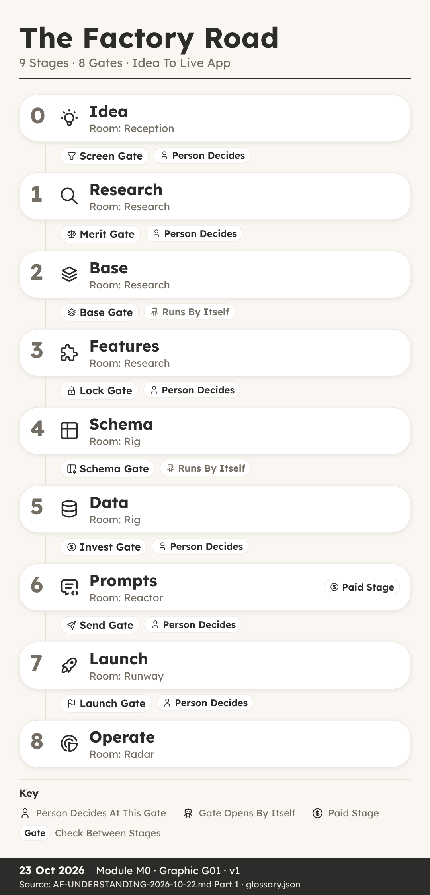{width=60%}

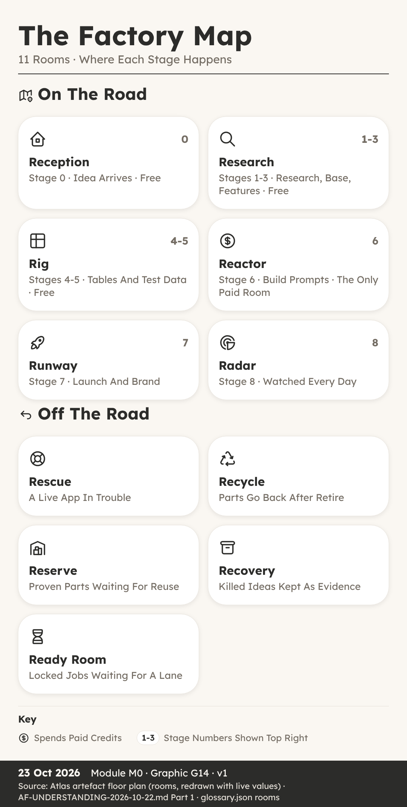{width=60%}

## What An App Is Made Of

**You can:** name the four things every app is made of and explain why a factory reuses tested parts.

**Key Ideas**

- **Ava, A Blank Page And Four Things.** Ava is thirteen and helps on Saturdays at The Tidy Paw, a dog grooming salon run by Juno Platt.
- **Screens Are What People See.** A screen is one page of an app that a person looks at and touches, such as a calendar, a form or a list.
- **Tables Hold The Data In Rows.** A table is where an app stores its data, laid out in rows and columns, rather like a spreadsheet.
- **Rules Decide Who Sees What.** A rule decides who may see something and who may change it.
- **People: Who Uses The App.** Every app has different kinds of people using it, and each kind needs different screens and different rules.
- **Most Apps Are Built By Hand.** Someone starts from a blank page, invents the screens, the tables and the rules from nothing, and makes hundreds of choices along the way.
- **A Factory Reuses Tested Parts.** Every idea travels the same road, in the same order, with the same checklist at each step.
- **Ava's Plan Before Building.** Ava now has a plan before she builds anything.

**Recap**

- Screens Show And Collect Information
- Tables Store Data In Rows And Columns
- Rules And Walls Decide Who Sees What

> **Why It Matters:** Name The Four Parts Before You Build Anything

**Quick Quiz**

1. What is a table in an app?

    A) A page that people tap
    B) Where data is stored in rows and columns
    C) A rule about prices
    D) A kind of screen for staff

2. In this course, what is a leak?

    A) A slow screen
    B) A missing booking
    C) Someone seeing data that is not theirs
    D) A spelling mistake on a page

3. What is kit K00?

    A) The floor that every app gets
    B) A kit for selling products
    C) A kit only for big apps
    D) The last kit to be added

4. Why is building every app by hand a problem when you want many apps?

    A) Hand-made apps cannot have screens
    B) Hand-made apps have no tables
    C) Hand-made apps are always free
    D) Lessons from one app are not carried to the next

**My Notes**

\_\_\_\_\_\_\_\_\_\_\_\_\_\_\_\_\_\_\_\_\_\_\_\_\_\_\_\_\_\_\_\_\_\_\_\_\_\_\_\_

\_\_\_\_\_\_\_\_\_\_\_\_\_\_\_\_\_\_\_\_\_\_\_\_\_\_\_\_\_\_\_\_\_\_\_\_\_\_\_\_

## The Road, Rooms And Gates

**You can:** name the 9 stages, describe the 11 rooms and say which gates need a person to decide.

**Key Ideas**

- **Sam Wanted It Done By Sunday.** One weekend he had an idea for a small app to help his gran keep track of her dog's walks and feeding times, and he wanted it finished by Sunday night.
- **Nine Stages, Numbered 0 To 8.** In the factory, every idea travels the same road of nine stages, numbered 0 to 8.
- **Free Stages, One Card, One Document.** Two things make this road easy to follow.
- **Six Rooms On The Main Road.** A room is simply where an app sits while it is at a certain stage, so anyone can see at a glance what is happening.
- **Five Rooms Beside The Road.** The other five rooms sit beside the road.
- **Eight Gates On The Main Road.** A gate is a stop point where the app must prove its stage is finished before it may move on.
- **A Person Decides At Some Gates.** Some gates open by themselves when every check passes.
- **After Launch, Three Lap Gates.** A live app goes round a lap, and three lap gates watch it.

**Recap**

- Nine Stages Run From 0 Idea To 8 Operate
- Eleven Rooms Show Where Each App Sits
- Gates Stop Apps, A Person Decides At Some

> **Why It Matters:** A Fixed Road Catches Mistakes Before Real People Do

**Quick Quiz**

1. How many stages are on the factory road?

    A) Seven
    B) Eight
    C) Nine, numbered 0 to 8
    D) Eleven

2. Which is the only stage that spends build credits?

    A) Stage 1, Research
    B) Stage 6, Prompts
    C) Stage 4, Schema
    D) Stage 8, Operate

3. Which of these gates opens by itself when every check passes?

    A) Lock
    B) Launch
    C) Merit
    D) Schema

4. What does the Slot check inside Invest make sure of?

    A) No more than 3 builds at once, with 1 lane kept for rescues
    B) The app has a logo
    C) The price is set
    D) Every screen has a colour

**My Notes**

\_\_\_\_\_\_\_\_\_\_\_\_\_\_\_\_\_\_\_\_\_\_\_\_\_\_\_\_\_\_\_\_\_\_\_\_\_\_\_\_

\_\_\_\_\_\_\_\_\_\_\_\_\_\_\_\_\_\_\_\_\_\_\_\_\_\_\_\_\_\_\_\_\_\_\_\_\_\_\_\_

# M01 · Stage 0 · Idea

*The Idea Form, The 20 Codes, The Kill Check*

How an idea enters the factory through the Idea Form, how the 20 codes describe it, and how the kill check, verdict, data role and Screen gate decide whether work starts.

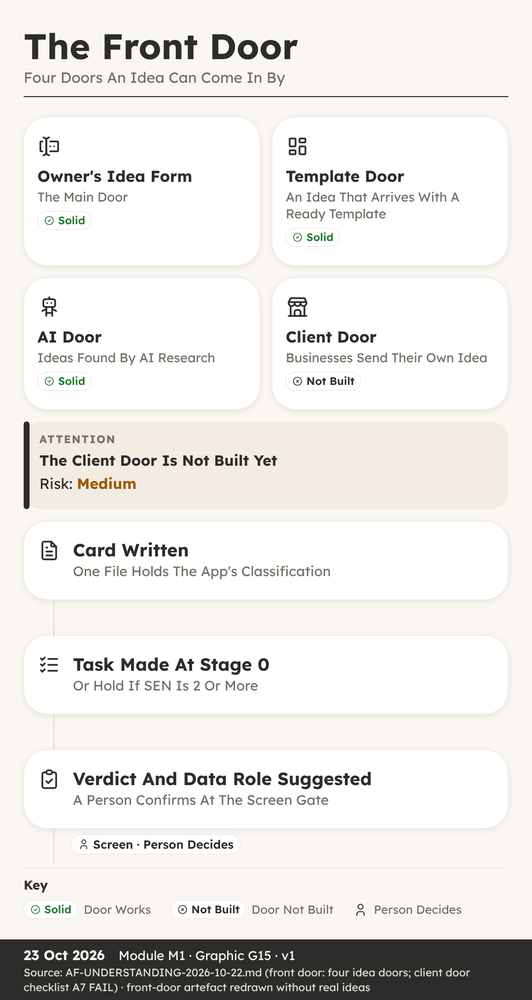{width=60%}

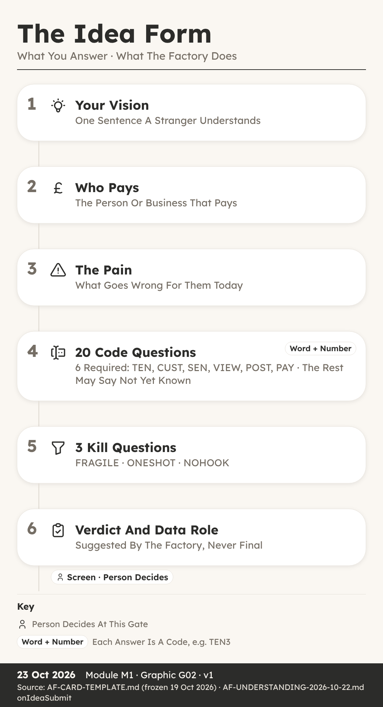{width=60%}

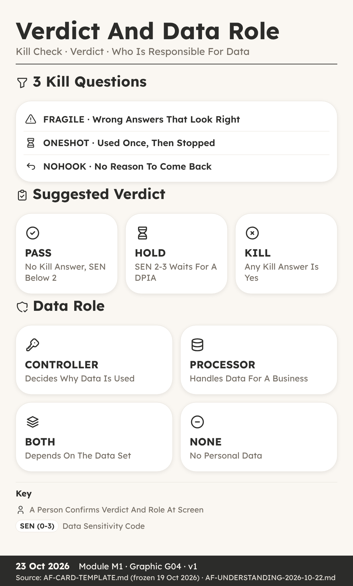{width=60%}

## The Idea Form

**You can:** write an idea as a one-line vision, a named payer and a clear pain, and name the four doors ideas come through.

**Key Ideas**

- **Two Pages Nobody Could Follow.** Isla's aunt, Mara Quill, breeds dogs and holds a dog breeding licence from her local council.
- **Stage 0 Starts In Reception.** Every idea begins at Stage 0, called Idea, in a room called Reception.
- **Four Doors Bring Ideas In.** The first is the Idea Form, filled in by a person with an idea.
- **Vision: What The App Is.** It opens with a short name and a vision.
- **Who Pays: Name The Payer.** This means the person or business whose money keeps the app running, not just who uses it.
- **Pain: The Problem In Plain Words.** The pain is the problem the app removes, written the way the customer would say it.
- **What Happens When You Submit.** When the form is sent, the factory engine does five things at once.
- **The Card Is Never Overwritten.** The card is the single home of the idea's classification.

**Recap**

- Start With Vision, Who Pays And Pain
- Ideas Arrive Through Four Doors
- The Card Is Kept, Never Overwritten

> **Why It Matters:** Three Short Answers Beat Two Pages Of Features

**Quick Quiz**

1. What three things does the brief on the Idea Form ask for?

    A) Colours, logo and name
    B) What it is, who pays and the pain
    C) Price, launch date and domain
    D) Screens, tables and rules

2. Which of the four idea doors is not built yet?

    A) The Idea Form
    B) The flip farm
    C) The AI door
    D) The client door

3. What is a reseller?

    A) A business that sells the app to its members under its own name
    B) A person who tests the app
    C) A rival product
    D) A kind of table

4. What happens when a card needs to change?

    A) The old card is deleted
    B) The card is overwritten
    C) A new version, such as v2, is saved beside it
    D) The idea starts again with a new name

**My Notes**

\_\_\_\_\_\_\_\_\_\_\_\_\_\_\_\_\_\_\_\_\_\_\_\_\_\_\_\_\_\_\_\_\_\_\_\_\_\_\_\_

\_\_\_\_\_\_\_\_\_\_\_\_\_\_\_\_\_\_\_\_\_\_\_\_\_\_\_\_\_\_\_\_\_\_\_\_\_\_\_\_

## The 20 Codes

**You can:** name the 4 code groups, read a code as a word plus a number and say which 6 codes are required.

**Key Ideas**

- **Rory Meets TEN, CUST And SEN.** Rory is twelve and was helping his sister fill in the Idea Form for Litterline.
- **Twenty Codes In Four Groups.** A code is a short name for one question about how the app handles businesses, people and data.
- **Each Answer Is A Word Plus Number.** Every answer is a word plus a number.
- **Group 1: Businesses.** TEN (0-6) asks how many businesses use the app and who sits above them.
- **Group 2: Who Signs In.** ROLE (0-2) asks whether all of a business's staff have the same access, or different roles with different access.
- **Group 3: Customers.** CUST (0-5) asks how far into a business's own customers the app goes.
- **Group 4: Public.** VIEW (0-2) asks whether a stranger can read anything without signing in.
- **Six Required, Fourteen Can Wait.** Six codes are required, because the factory cannot judge an idea without them: TEN, CUST, SEN, VIEW, POST and PAY.

**Recap**

- 20 Codes Sit In 4 Groups
- Each Answer Is A Word Plus A Number
- Six Required, Fourteen May Be Not Yet Known

> **Why It Matters:** The Codes Decide Which Walls The App Needs

**Quick Quiz**

1. How many groups are the 20 codes sorted into?

    A) 2
    B) 3
    C) 4
    D) 5

2. Which six codes must always be answered?

    A) TEN, CUST, SEN, VIEW, POST and PAY
    B) ROLE, JOIN, HELP, GUEST, BELONG and SHARE
    C) PRICE, BRAND, SEND, EXIT, POOL and MEET
    D) Any six you choose

3. What does SEN 3 mean?

    A) Ordinary data
    B) Personal data
    C) Health or clinical data
    D) Data about children

4. What does a question mark mean as an answer to one of the 14 optional codes?

    A) The answer is zero
    B) Not yet known
    C) The code does not apply
    D) The idea is killed

**My Notes**

\_\_\_\_\_\_\_\_\_\_\_\_\_\_\_\_\_\_\_\_\_\_\_\_\_\_\_\_\_\_\_\_\_\_\_\_\_\_\_\_

\_\_\_\_\_\_\_\_\_\_\_\_\_\_\_\_\_\_\_\_\_\_\_\_\_\_\_\_\_\_\_\_\_\_\_\_\_\_\_\_

## Kill Check, Verdict And Data Role

**You can:** apply the three kill questions, work out the suggested verdict, name the four data roles and explain the Screen gate.

**Key Ideas**

- **Leo's Idea Stopped At Stage 0.** Leo had an idea he loved: a version of Trimtable that would make one neat printed price list for a grooming salon.
- **Three Kill Questions.** The kill check is three questions, each with a code name.
- **Any Yes Suggests KILL.** If any one of the three answers is yes, the suggested verdict is KILL.
- **High SEN (0-3) Means HOLD.** The engine suggests HOLD when SEN, the sensitivity code, is 2 or 3.
- **PASS: No Kill, SEN Below 2.** An idea passes when no kill answer is yes and SEN is below 2, meaning the data is ordinary or personal, but not health and not children.
- **Data Roles: Who Is Responsible.** Alongside the verdict, the engine suggests a data role.
- **The Role Picks The Duty Lines.** Each role brings its own pack of checklist lines that the app must complete later.
- **The Screen Gate: Start Work.** Now the idea reaches its first gate: Screen, between Stage 0 and Stage 1.

**Recap**

- Three Kill Questions: FRAGILE, ONESHOT, NOHOOK
- HOLD When SEN (0-3) Is 2 Or More
- Data Role: CONTROLLER, PROCESSOR, BOTH Or NONE

> **Why It Matters:** Stopping A Weak Idea At Stage 0 Costs Nothing

**Quick Quiz**

1. Which kill question asks whether people would use the app once and stop?

    A) FRAGILE
    B) NOHOOK
    C) ONESHOT
    D) SEN

2. No kill answer is yes, but SEN is 3. Which verdict does the engine suggest?

    A) PASS
    B) HOLD
    C) KILL
    D) GO

3. What does a PROCESSOR do?

    A) Decides why personal data is used
    B) Holds no personal data
    C) Sells the app under its own name
    D) Handles personal data on behalf of another business

4. Which idea can never pass the Screen gate automatically?

    A) An idea where a kill is suggested
    B) An idea with SEN 1
    C) An idea from the Idea Form with no flags
    D) An idea with a short name

**My Notes**

\_\_\_\_\_\_\_\_\_\_\_\_\_\_\_\_\_\_\_\_\_\_\_\_\_\_\_\_\_\_\_\_\_\_\_\_\_\_\_\_

\_\_\_\_\_\_\_\_\_\_\_\_\_\_\_\_\_\_\_\_\_\_\_\_\_\_\_\_\_\_\_\_\_\_\_\_\_\_\_\_

# M02 · Stage 1 · Research

*The Research Sweep, The Merit Gate*

How the free research sweep checks rivals, customer words, gaps, market size and the rules, and how a person decides at the Merit gate whether the idea is worth building.

## The Research Sweep

**You can:** list the parts of the research sweep and explain why customers' own words come before our own ideas.

**Key Ideas**

- **Esme Expected Charts, Owners Wanted Logs.** Esme's neighbour runs Hollin Lane Kennels, a boarding kennel.
- **First, Check What We Already Own.** Once an idea passes Screen, it moves to Stage 1, Research, in the room of the same name.
- **The Competitor Sweep: 3-5 Rivals.** A competitor, or rival, is any product people already use to solve the same problem.
- **Customer Words, Exactly As Written.** This means 10 exact phrases people use for the pain, and 10 for the result they want, copied from reviews and groups word for word.
- **The Gap Matrix Finds Our Edge.** With rivals and customer words in hand, we build a gap matrix.
- **Market Size, Trend And Lawful Data.** Market size means roughly how many possible customers there are, and the trend means whether that number is growing or shrinking.
- **The Rules Flag Warns The Gate.** Then comes the rules flag, short for the regulatory flag.
- **Rank: Market, Profit, Risk, Confidence.** Finally, everything is pulled together into an idea code and a rank.

**Recap**

- Check What We Already Own First
- Collect Rivals, Reviews And Customers' Exact Words
- Gap Matrix, Market, Rules Flag, Then Rank

> **Why It Matters:** Customers' Own Words Beat Our Own Guesses

**Quick Quiz**

1. Which reviews does the competitor sweep look at most closely?

    A) 5 star reviews
    B) 4 star reviews
    C) 3 star reviews
    D) 1 and 2 star reviews

2. How many exact customer phrases are collected for the pain?

    A) 3
    B) 5
    C) 10
    D) 20

3. What does the gap matrix end with?

    A) The 3 strongest gaps
    B) A finished app
    C) A price list
    D) A list of test accounts

4. Who completes the rules flag?

    A) An AI tool on its own
    B) A person, because judging the law needs a human
    C) The first customer
    D) Nobody, it is optional

**My Notes**

\_\_\_\_\_\_\_\_\_\_\_\_\_\_\_\_\_\_\_\_\_\_\_\_\_\_\_\_\_\_\_\_\_\_\_\_\_\_\_\_

\_\_\_\_\_\_\_\_\_\_\_\_\_\_\_\_\_\_\_\_\_\_\_\_\_\_\_\_\_\_\_\_\_\_\_\_\_\_\_\_

## The Merit Gate

**You can:** explain the four Merit verdicts as a decision tree, say why a person decides and describe the DPIA hold.

**Key Ideas**

- **Ruby Wanted Yes, Got RESHAPE.** Ruby is fourteen and had followed Litterline all the way through research.
- **Merit Asks: Is It Worth Building.** Merit is the gate between Stage 1, Research, and Stage 2, Base.
- **Why A Person Decides At Merit.** Because Merit is the regulatory and data protection kill.
- **Four Verdicts As A Decision Tree.** Merit gives one of four verdicts: GO, HOLD, KILL or RESHAPE.
- **RESHAPE Changes, HOLD Waits.** RESHAPE means the idea is worth something, but one part must change first.
- **KILL At Merit Goes To Recovery.** It burns the id, which means that number is never handed to another idea.
- **The DPIA Hold For High SEN.** There is one special hold to know about.
- **GO Must Be Carried And Written.** When the verdict is GO, it must be carried.

**Recap**

- Merit Asks: Is It Worth Building
- GO, HOLD, KILL Or RESHAPE, As A Decision Tree
- SEN (0-3) At 2 Or More Needs A DPIA

> **Why It Matters:** A Person Judges The Law Before Anything Is Built

**Quick Quiz**

1. What question does the Merit gate ask?

    A) Start work on this idea?
    B) Freeze the feature list?
    C) Is it worth building?
    D) Open it to real users?

2. At Merit you can name exactly what must change. Which verdict fits?

    A) GO
    B) KILL
    C) HOLD
    D) RESHAPE

3. Why does RECYCLE never apply at Merit?

    A) No parts have been built yet
    B) Merit is automatic
    C) RECYCLE costs too much
    D) The card is deleted at Merit

4. What does the rule "a move writes, or it did not happen" mean?

    A) Every app needs a writer
    B) The verdict must be written to the card and register in the same session
    C) The idea must be written twice
    D) Only written ideas can enter Reception

**My Notes**

\_\_\_\_\_\_\_\_\_\_\_\_\_\_\_\_\_\_\_\_\_\_\_\_\_\_\_\_\_\_\_\_\_\_\_\_\_\_\_\_

\_\_\_\_\_\_\_\_\_\_\_\_\_\_\_\_\_\_\_\_\_\_\_\_\_\_\_\_\_\_\_\_\_\_\_\_\_\_\_\_

# M03 · Stage 2 · Base

*Picking A Base, Bricks, Shelves And Kits*

How the factory picks a proven base to start from, and the bricks, shelves and kits every app is assembled from.

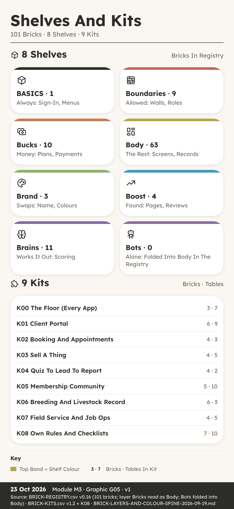{width=60%}

## Picking A Base

**You can:** explain how the factory picks a base, copies the template and passes the Base gate.

**Key Ideas**

- **Starting From Nothing Is Slow.** He had an idea for a booking desk for dog groomers, a bit like our sample app Trimtable, and it had just passed the Merit gate.
- **Stage 2 Is Called Base.** Stage 2 in the factory is called Base.
- **Remix Or Rebuild.** To remix means to start from an existing base app that the factory already owns, kept on a shelf of bases, and change it.
- **The Dedup Check Looks For Twins.** Dedup is short for de-duplication, which means removing copies.
- **Copy The Template, Then Save A Backup.** Next, the factory clones the template app folder.
- **Bricks, Kits And Colours Listed Once.** A brick is one reusable part, such as booking or invoices, and a kit is a named bundle of bricks that ship together.
- **A Security Vet With Two Accounts.** A base can look fine and still leak.
- **The Base Gate Opens By Itself.** It is an auto gate, which means no person has to click yes.

**Recap**

- Remix An Owned Base Or Rebuild As BESPOKE
- Dedup Check And Export ZIP Come First
- Base Gate Is Auto Once Base Named And Vetted

> **Why It Matters:** A Proven Base Means Only New Parts Get Built

**Quick Quiz**

1. What does it mean to remix at Stage 2?

    A) Start fresh with a blank project
    B) Start from an existing base the factory owns
    C) Copy another company's app
    D) Skip the Base stage

2. What must come with a decision to rebuild as BESPOKE?

    A) A dedup check that proved nothing suitable exists
    B) A paid build prompt
    C) A finished sales page
    D) A signed letter from the club

3. Who moves the app through the Base gate?

    A) A person always clicks yes
    B) The customer
    C) The engine, automatically, when every line is done
    D) The reseller club

4. Why is an Export ZIP taken as soon as the base is chosen?

    A) To send it to customers
    B) To make the app faster
    C) To publish the app
    D) To keep a safe copy to go back to

**My Notes**

\_\_\_\_\_\_\_\_\_\_\_\_\_\_\_\_\_\_\_\_\_\_\_\_\_\_\_\_\_\_\_\_\_\_\_\_\_\_\_\_

\_\_\_\_\_\_\_\_\_\_\_\_\_\_\_\_\_\_\_\_\_\_\_\_\_\_\_\_\_\_\_\_\_\_\_\_\_\_\_\_

## Bricks, Shelves And Kits

**You can:** explain what bricks, shelves and kits are, and why K00 sits under every app.

**Key Ideas**

- **Sixty Loose Parts, Half Of Them Repeats.** Isla was planning Litterline, our sample licence and records hub for dog breeders.
- **A Brick Is One Reusable Part.** A brick is one reusable part of an app that does one job.
- **Eight Shelves On A Colour Spine.** Bricks sit on shelves, and the shelves are sorted on a colour spine, which is a fixed order where each shelf has its own colour.
- **Most Bricks Live In Body.** If you count the registry, the shelves are not even.
- **A Kit Is A Named Bundle.** A kit is a named bundle of bricks that ship together, so one idea is picked as one thing with a known cost, not as fifteen loose picks.
- **K00 Is The Floor Under Every App.** It is called the floor, and it is forced onto every app.
- **Litterline Picks Four Kits.** It uses K00, the floor, like every app.
- **Kits First, Then Loose Bricks.** Kits do not stop you adding single bricks.

**Recap**

- A Brick Is One Reusable Part With An Id
- 101 Bricks Sit On 8 Colour Spine Shelves
- 9 Kits K00-K08, With K00 Under Every App

> **Why It Matters:** Named Kits Turn Loose Wishes Into A Clean List

**Quick Quiz**

1. How many bricks are in BRICK-REGISTRY v0.16?

    A) 88
    B) 101
    C) 63
    D) 20

2. What is K00?

    A) An optional booking kit
    B) A kit only for resellers
    C) A retired kit
    D) The floor, forced onto every app

3. Which three bricks make up K00?

    A) BR-BASICS, BR-TENANCY and BR-LEGAL
    B) BR-BOOKING, BR-FORMS and BR-DOCS
    C) BR-PEDIGREE, BR-CLINICAL and BR-LITTERS
    D) BR-REVIEWS, BR-GALLERY and BR-CHAT

4. Why does the Body shelf hold the most bricks?

    A) Body bricks are cheaper
    B) Body is the only free shelf
    C) The registry files bot bricks under Body
    D) Every kit lives on Body

**My Notes**

\_\_\_\_\_\_\_\_\_\_\_\_\_\_\_\_\_\_\_\_\_\_\_\_\_\_\_\_\_\_\_\_\_\_\_\_\_\_\_\_

\_\_\_\_\_\_\_\_\_\_\_\_\_\_\_\_\_\_\_\_\_\_\_\_\_\_\_\_\_\_\_\_\_\_\_\_\_\_\_\_

# M04 · Stage 3 · Features

*Kits And Bricks, Who Sees What, Duties, The Lock Gate*

How the first version of an app is scoped, mapped and mocked up, how its duties are listed, and how the Lock gate freezes the feature list.

## Choosing Kits And Bricks

**You can:** describe how the first version of an app is scoped, mapped and mocked up before Lock.

**Key Ideas**

- **Sam Wanted Everything In Version One.** Sam was helping to plan Stayproof, our sample inspection pack for boarding kennels.
- **Stage 3 Picks What Goes In.** Stage 3 is where the bricks and kits from Stage 2 become a real feature list.
- **Who Sees And Does What.** It has one line for each role and each action.
- **Every Word And Colour Is Data.** Every word, label, colour and category the app shows is listed and stored as rows in a table, never typed into the code.
- **Payment Route And Tenancy Level.** The third and fourth notes are about money and businesses.
- **The Launch-Minimum Scope.** It is the fewest tables and screens that let a first customer pay and use the app.
- **A Clickable Mockup, Phone First.** Before anything is built, the app gets a clickable mockup.
- **Journeys Are Part Of The Design.** One more thing goes into Stage 3: a journey map.

**Recap**

- Five Notes Go In The Build Pack Before Lock
- Launch-Minimum Means Fewest Screens A Customer Pays For
- Clickable Mockup Phone First, Built From The Research

> **Why It Matters:** Small And Clear Beats Big And Untested

**Quick Quiz**

1. What is the launch-minimum scope?

    A) Every feature a customer could ever want
    B) The fewest tables and screens that let a first customer pay and use it
    C) The sales page
    D) The list of rivals

2. Why are words, labels and colours stored as data?

    A) So a brand swap is an edit to rows, not a paid build turn
    B) To make the app slower
    C) Because code cannot hold words
    D) So customers can change the code

3. Where should a who-sees-and-does-what check happen?

    A) Only on the screen
    B) In the sales page
    C) In the customer's email
    D) On the server side, where the data is held

4. What must the first build include, by the checklist rule?

    A) A chat room
    B) Every rival feature
    C) The top three complaints fixed and one thing no rival has
    D) A shop

**My Notes**

\_\_\_\_\_\_\_\_\_\_\_\_\_\_\_\_\_\_\_\_\_\_\_\_\_\_\_\_\_\_\_\_\_\_\_\_\_\_\_\_

\_\_\_\_\_\_\_\_\_\_\_\_\_\_\_\_\_\_\_\_\_\_\_\_\_\_\_\_\_\_\_\_\_\_\_\_\_\_\_\_

## Duties And The Lock Gate

**You can:** explain the obligations ledger and what must be true before the Lock gate freezes the feature list.

**Key Ideas**

- **A List Everyone Liked.** Ava and her mum were planning Trimtable, our sample booking desk for dog groomers, with a salon called The Tidy Paw in mind.
- **Duties Come From A Shared Ledger.** A duty, or obligation, is something that must exist or be done before a stage or a paid build can go ahead.
- **The App Gets Its Own Ledger.** At Stage 3 the app gets its own obligations ledger, section 3.7 of its document.
- **Some Duties Belong To One Person.** Some rows can only be done by a person, not an agent.
- **Open Duties Block The Gate.** Here is the rule that gives the ledger its teeth.
- **Named Payer And A Legal Check.** The Lock gate sits between Stage 3 and Stage 4, and it has two firm conditions.
- **A Person Always Decides At Lock.** There is a reason it is always a person.
- **After Lock, The App Becomes Real.** Lock is also the moment the app is created on the build platform, with its own number and a short web name called a slug.

**Recap**

- Every App Gets Its Own Obligations Ledger
- Open Duties Due At A Gate Block It
- Lock Needs A Named Payer, Legal Check And Yes

> **Why It Matters:** Freezing The List Stops Drift And Surprise Costs

**Quick Quiz**

1. What is OBLIGATIONS.csv?

    A) A list of rival apps
    B) The app's price list
    C) A shared file of duties keyed to what causes them
    D) The sales page

2. What happens when a ledger row due at a gate is still open?

    A) The gate cannot pass
    B) The gate passes with a warning
    C) The row is deleted
    D) The app is retired

3. Which two conditions does the Lock gate need?

    A) A sales page and a domain
    B) Two test accounts
    C) A paid prompt and a refund
    D) A named payer and a legal check

4. What happens to the out list after Lock?

    A) Its items join automatically next week
    B) It is closed, and items return only through a new gate
    C) It is sent to customers
    D) It becomes the sales page

**My Notes**

\_\_\_\_\_\_\_\_\_\_\_\_\_\_\_\_\_\_\_\_\_\_\_\_\_\_\_\_\_\_\_\_\_\_\_\_\_\_\_\_

\_\_\_\_\_\_\_\_\_\_\_\_\_\_\_\_\_\_\_\_\_\_\_\_\_\_\_\_\_\_\_\_\_\_\_\_\_\_\_\_

# M05 · Stage 4 · Schema

*Tables And Columns, Access Modes, Walls, Table Tests*

How the codes and kits decide an app's tables, how each table is built, set and recorded, and how the walls are tested before the Schema gate.

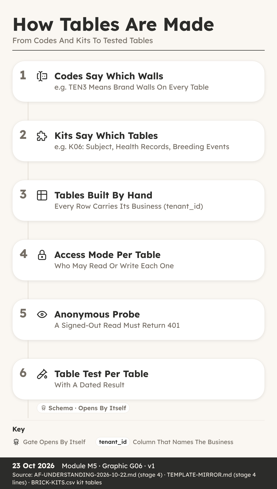{width=60%}

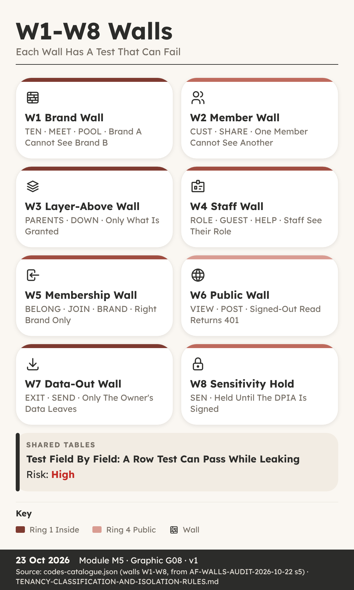{width=60%}

## How The System Makes The Tables

**You can:** explain how codes and kits decide the tables, and how each table is built, set and recorded.

**Key Ideas**

- **Nia Thought Tables Were Easy.** Nia keeps the spreadsheet for her family's walking group, so when she heard Stage 4 was about tables, she thought it would be easy.
- **A Schema Is The Plan Of Tables.** A schema is the plan of the tables that hold the data: which tables exist, which columns each one has, and who may read or write them.
- **Codes And Kits Decide The Tables.** The kits chosen earlier each bring their own tables.
- **A Spec First, Then Built By Hand.** Before anything is created, the tables and columns are written out as a spec, short for specification, saved as a CSV file.
- **Access Modes Say Who Can Read.** Every table has an access mode, a setting that says who may read and write its rows.
- **Probe Every Table While Signed Out.** Deciding a mode is not the same as having it.
- **Every Table Gets A Register Row.** The last piece is the table register, section 4.0 of the app's document.
- **Never Rename, Add And Migrate Instead.** One rule from the duties file is worth learning by heart.

**Recap**

- Kits Bring The Tables, Codes Shape The Columns
- Set Access Mode At Creation, Then Probe Signed Out
- Every Table Gets A 4.0 Register Row And Reason

> **Why It Matters:** Tables Planned Once Are Cheap, Fixed Later Are Not

**Quick Quiz**

1. What is a schema?

    A) The sales plan
    B) The plan of the tables that hold the data
    C) A type of brick
    D) The launch checklist

2. Why is the access mode set when a table is created?

    A) Because it looks tidier
    B) Because the customer asks for it
    C) Because only resellers can change it
    D) Because setting it then is free and changing it later is a billed turn

3. What does an anonymous probe do?

    A) Sends a test request with nobody signed in
    B) Deletes old tables
    C) Renames columns
    D) Sends emails to customers

4. What is the safe way to change a column name?

    A) Rename it directly
    B) Delete the table
    C) Add a new column, migrate the data, leave the old one unread
    D) Ask customers to type the data again

**My Notes**

\_\_\_\_\_\_\_\_\_\_\_\_\_\_\_\_\_\_\_\_\_\_\_\_\_\_\_\_\_\_\_\_\_\_\_\_\_\_\_\_

\_\_\_\_\_\_\_\_\_\_\_\_\_\_\_\_\_\_\_\_\_\_\_\_\_\_\_\_\_\_\_\_\_\_\_\_\_\_\_\_

## Walls And Table Tests

**You can:** name the eight walls and describe the table tests that must pass before the Schema gate.

**Key Ideas**

- **Seeing Someone Else's Clients.** One morning, the booking app the salon used showed her another salon's client list, names and phone numbers included.
- **A Wall Keeps Two Parties Apart.** In the factory, a wall is a rule that keeps two parties' data apart.
- **The Eight Walls W1-W8.** The full set has eight walls, numbered W1-W8, and most codes on the idea card point to one.
- **Each Table Gets The Right Test.** Stage 4 ends with table tests, section 4.4 of the document.
- **A 401 Means Not Allowed In.** 401 is a status code, a number a web server sends back with every answer.
- **Shared Tables Need Field-Level Tests.** Imagine one dog's record that two breeders both hold a claim on, with each allowed to see different fields.
- **Every Test Has A Dated Result.** A test without a result is just a hope.
- **The Schema Gate Passes By Itself.** When every Stage 4 checklist line is done, and no section of the document still says pending, the engine moves the app on without anyone clicking yes.

**Recap**

- Eight Walls W1-W8 Keep Parties Apart
- Brand-Wall, User-Wall And Anonymous 401 Table Tests
- Shared Tables Need Field-Level Tests, Then Auto Schema Gate

> **Why It Matters:** A Test That Can Fail Is The Only Proof

**Quick Quiz**

1. Which wall keeps one business's data away from another business?

    A) W1 Brand Wall
    B) W6 Public Wall
    C) W7 Data-Out Wall
    D) W8 Sensitivity Hold

2. What should an anonymous read of a control table return?

    A) 200 with rows
    B) A list of tenants
    C) 401
    D) The sales page

3. Why is a row-level test not enough on a shared table?

    A) Shared tables have no rows
    B) It is too slow
    C) Shared tables are always public
    D) A shared row has no tenant id, so the test can pass while fields leak

4. Who moves the app through the Schema gate?

    A) A person always clicks yes
    B) The engine, automatically, when every line is done
    C) The customer
    D) The reseller club

**My Notes**

\_\_\_\_\_\_\_\_\_\_\_\_\_\_\_\_\_\_\_\_\_\_\_\_\_\_\_\_\_\_\_\_\_\_\_\_\_\_\_\_

\_\_\_\_\_\_\_\_\_\_\_\_\_\_\_\_\_\_\_\_\_\_\_\_\_\_\_\_\_\_\_\_\_\_\_\_\_\_\_\_

# M06 · Stage 5 · Data

*Test Identities, Test Tenants, The Leak Test Plan*

How the last free stage gets an app ready for a paid build: two contrasting test brands, named test members, a test plan with negative cases, a credit estimate and the Invest gate.

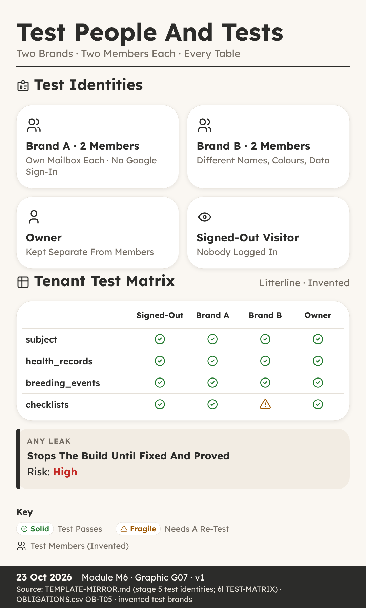{width=60%}

## Test Identities And Test Tenants

**You can:** explain why every app needs two contrasting test brands and named test members before any paid build starts.

**Key Ideas**

- **One Salon Cannot Prove A Wall.** He is fourteen, and he was helping to test Trimtable, the booking and client desk for dog groomers.
- **Stage 5 Is The Last Free Stage.** It happens in the room called Rig, the same room where the tables were built by hand in Stage 4.
- **Two Test Tenants, Never Just One.** A tenant is one business that uses the app, with its own name and its own data.
- **Make The Two Brands Look Different.** That word comes straight from the duty list: the second tenant gets different names, different lanes and different colours, so that a leak is visible.
- **Test Rows Must Be Easy To Find.** On the build platform, the preview version of the app and the live version share one database.
- **Two Test Members For Every Brand.** A test identity is a pretend person with a real sign-in, used only for testing.
- **No Google Sign-In, No Agent Accounts.** First, no Google single sign-on for test members.
- **Walk It As A Brand-New Person.** One last step comes before any build: the new-account walk.

**Recap**

- Two Contrasting Test Tenants Make A Leak Visible
- Two Test Members Per Brand, Each With Own Mailbox
- No Google Sign-In, And Agents Never Create Accounts

> **Why It Matters:** A Test That Cannot Fail Proves Nothing

**Quick Quiz**

1. Why does Stage 5 need at least two test tenants?

    A) Two tenants make the app load faster
    B) One tenant cannot prove that data stays behind its wall
    C) The build platform charges less for two tenants
    D) The sales page needs two brand names

2. What makes the two test tenants contrasting?

    A) They use the same colours so tests are fair
    B) They share one owner account
    C) They use the same dog names
    D) Different names, lanes and colours

3. How do test members sign in?

    A) With an email and password or a magic link, each with their own mailbox
    B) With the owner's Google account
    C) With single sign-on through any account
    D) With one shared team login

4. Who sets up the test identities?

    A) An AI agent, during the build
    B) Any test member who needs one
    C) The factory owner, once per app, by hand
    D) The first paying customer

**My Notes**

\_\_\_\_\_\_\_\_\_\_\_\_\_\_\_\_\_\_\_\_\_\_\_\_\_\_\_\_\_\_\_\_\_\_\_\_\_\_\_\_

\_\_\_\_\_\_\_\_\_\_\_\_\_\_\_\_\_\_\_\_\_\_\_\_\_\_\_\_\_\_\_\_\_\_\_\_\_\_\_\_

## The Leak And Tenant Tests

**You can:** describe a test plan with negative cases, read a test matrix and explain what the Invest gate decides.

**Key Ideas**

- **Her Checklist Only Tested Success.** She wrote a checklist to test Stayproof, the inspection pack for boarding kennels, using Hollin Lane Kennels as her example.
- **One Row Per Test, With Its Negative.** In Stage 5 the factory writes a test plan.
- **The Test Matrix: Every Table, Four Visitors.** The tests are laid out as a test matrix.
- **A Leak Stops The Build.** A leak is when someone can see or change data that belongs to somebody else.
- **Tests Are Written Before The Prompts.** The leak tests are written now, in Stage 5, together with the build prompts, before a single credit is spent.
- **The Credit Estimate And The Stop Rule.** The factory estimates how many credits the build will take and writes it on the app's card as the word credits, then a number.
- **The Invest Gate (5-6) And Slot Check.** Stage 5 ends at the Invest gate, from 5 to 6.
- **Ready For The Paid Stage.** So when Stage 5 closes, the app has two contrasting test brands, named test members, a test plan with a negative case on every row, and a test matrix covering every table for four kinds of visitor.

**Recap**

- Every Test Row Carries Its Negative Case
- Matrix Covers Every Table For Four Kinds Of Visitor
- Invest Passes Itself At 1,500 Credits Or Less

> **Why It Matters:** Tests Written First Cannot Bend To Fit Results

**Quick Quiz**

1. What is a negative case?

    A) A test that always passes
    B) A test of the sales page wording
    C) A test that checks something forbidden really fails
    D) A test that is only run on a phone

2. Which four kinds of visitor does the test matrix cover?

    A) Owner, reseller, customer and builder
    B) Signed out, Brand A member, Brand B member and owner
    C) Desktop, phone, tablet and laptop
    D) Breeder, groomer, kennel and club

3. What happens when a leak is found during the build?

    A) It is noted for a later version
    B) Only the owner is told
    C) The leak status stays as not tested
    D) The build stops

4. When does the Invest gate pass by itself?

    A) When the estimate is 1,500 credits or less and the month's stop line is not passed
    B) Whenever the test plan is written
    C) When two test members exist
    D) Never, the owner always decides

**My Notes**

\_\_\_\_\_\_\_\_\_\_\_\_\_\_\_\_\_\_\_\_\_\_\_\_\_\_\_\_\_\_\_\_\_\_\_\_\_\_\_\_

\_\_\_\_\_\_\_\_\_\_\_\_\_\_\_\_\_\_\_\_\_\_\_\_\_\_\_\_\_\_\_\_\_\_\_\_\_\_\_\_

# M07 · Stage 6 · Prompts

*One Surface Per Prompt, The Walls Block, Tests After Every Paid Turn*

How the only paid stage works: small build prompts that carry their own tests and rollback step, the six steps after every paid turn, and the Send gate.

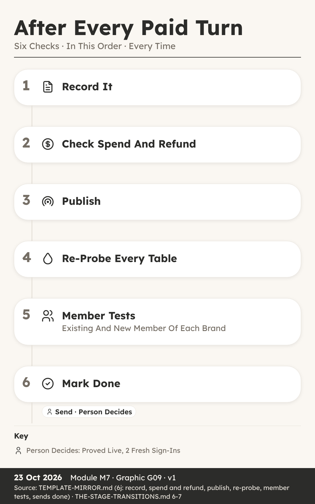{width=60%}

## How Build Prompts Are Written

**You can:** list what every paid build prompt must carry and explain why each prompt does only one job.

**Key Ideas**

- **One Request, Two Jobs, Big Risk.** He was watching his dad plan a change to Trimtable for Juno Platt's salon, The Tidy Paw.
- **Stage 6 Is The Only Paid Stage.** It happens in the room called Reactor, and it is the only paid stage in the whole factory.
- **One Goal, One Surface.** The first rule is one goal, one surface.
- **The Blocks Every Prompt Carries.** A context block lists exactly which files the builder may read, and nothing else.
- **Each Prompt Carries Its Own Test.** Where the app has brands, the test covers both walls: the brand wall, where Brand B cannot see Brand A, and the member wall, where one member cannot see another member's rows.
- **A Rollback Step For Every Prompt.** Each paid prompt also carries a written rollback step.
- **The Go Word And The Sends List.** Before any prompt goes out, the factory writes a three-line pre-send report and adds a task to a list called Sends.
- **Small, Tested And Reversible.** So a good build prompt is small, tested and reversible.

**Recap**

- One Goal, One Surface: An And Means Two
- Walls Block, Test And Rollback In Every Prompt
- Owner Gives The Go Word Before Each Paid Send

> **Why It Matters:** Small Prompts Fail Small And Undo Easily

**Quick Quiz**

1. Why is Stage 6 different from every other stage?

    A) It is the only stage with a gate
    B) It is the only stage that uses tables
    C) It is the only stage run by the customer
    D) It is the only stage that spends credits

2. What does the rule 'an and means two prompts' mean?

    A) A request with two jobs is split into two prompts
    B) Every prompt must be sent twice
    C) Two people must write each prompt
    D) Each prompt must name two brands

3. What does fail closed mean in the walls block?

    A) The app shuts down at night
    B) Failed prompts are deleted
    C) When in doubt, the app refuses access
    D) The builder closes every file it opens

4. Who runs the tests a prompt carries?

    A) The AI builder, inside its own turn
    B) The factory's agents, from outside the app, after the turn
    C) The first real customer
    D) Nobody, the builder's screen is enough

**My Notes**

\_\_\_\_\_\_\_\_\_\_\_\_\_\_\_\_\_\_\_\_\_\_\_\_\_\_\_\_\_\_\_\_\_\_\_\_\_\_\_\_

\_\_\_\_\_\_\_\_\_\_\_\_\_\_\_\_\_\_\_\_\_\_\_\_\_\_\_\_\_\_\_\_\_\_\_\_\_\_\_\_

## After Every Paid Turn

**You can:** put the six after-turn steps in order and explain what the Send gate needs before an app moves on.

**Key Ideas**

- **Done On Screen Is Not Done.** The builder's screen said the new litter page was done, and Ava wanted to message Mara Quill, the breeder waiting for it, straight away.
- **Six Steps, Always In This Order.** After every paid turn, the factory follows six steps, always in the same order.
- **Step One: Record On Landing.** Step one is record on landing, and it happens before any check, test or reply.
- **Step Two: Spend And Refund Check.** Step two compares what the turn cost with the written estimate.
- **Steps Three And Four: Publish, Then Probe.** Step three is publish, which puts the new version on the live site.
- **Step Five: Member Tests On Both Brands.** After every paid turn, an existing member and a brand-new member of each brand do the app's core action from start to finish.
- **The Send Gate (6-7): Proved Live.** Step six marks the send as done, and a scorecard is written: what was predicted against what actually happened.
- **Done Means Proved Live.** So here is the lesson in one line: done means proved live from outside.

**Recap**

- Record First, Before Any Check Or Reply
- Publish, Then Probe Every Table Signed Out
- Send Gate Needs Proof Live And Two Fresh Sign-Ins

> **Why It Matters:** A Turn Is Only Done When Proved Live

**Quick Quiz**

1. What is the first step after every paid turn?

    A) Publish the new version
    B) Record the prompt and reply word for word
    C) Run the member tests
    D) Tell the customer it is ready

2. A file the prompt named did not change after the turn. What does the rule say?

    A) Send the same prompt again at once
    B) Ignore it if the screen looks fine
    C) Change the file by hand and move on
    D) The turn failed, so raise a refund ticket and do not resend blind

3. Why does the factory check the live code before testing?

    A) A cache can still be showing the old version
    B) The builder asks it to
    C) Live code is cheaper to test
    D) Testing before publishing is not allowed by law

4. What does the Send gate need before the app moves to Launch?

    A) A finished sales page
    B) A full month of real users
    C) Proved live, with two fresh sign-ins
    D) A new domain name

**My Notes**

\_\_\_\_\_\_\_\_\_\_\_\_\_\_\_\_\_\_\_\_\_\_\_\_\_\_\_\_\_\_\_\_\_\_\_\_\_\_\_\_

\_\_\_\_\_\_\_\_\_\_\_\_\_\_\_\_\_\_\_\_\_\_\_\_\_\_\_\_\_\_\_\_\_\_\_\_\_\_\_\_

# M08 · Stage 7 · Launch

*Sales Page, Domain, Funnels, The Launch Walk, The Launch Gate*

How an app meets the outside world: a sales page, a domain, ClickFunnels funnels, a plan carried safely from the landing page, the launch tests and the Launch gate.

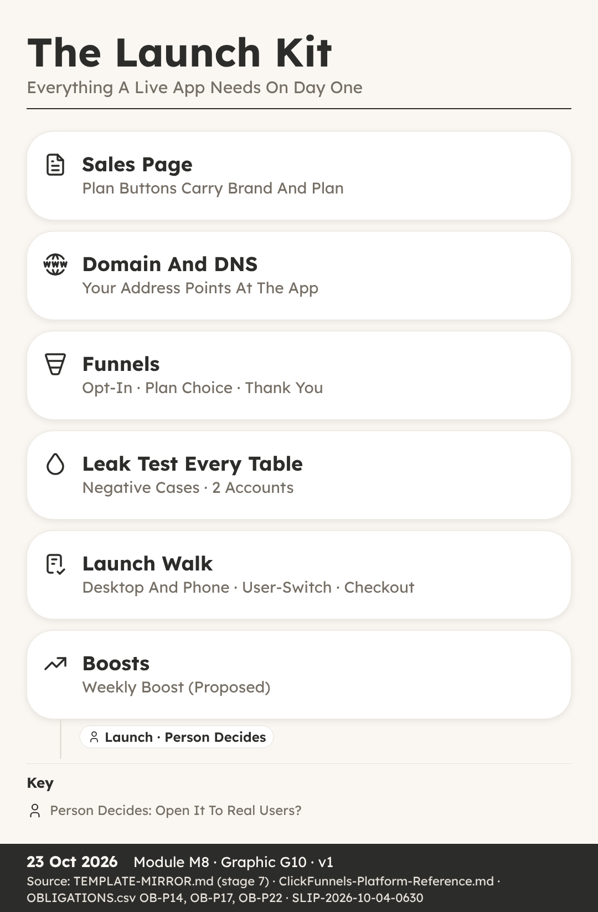{width=60%}

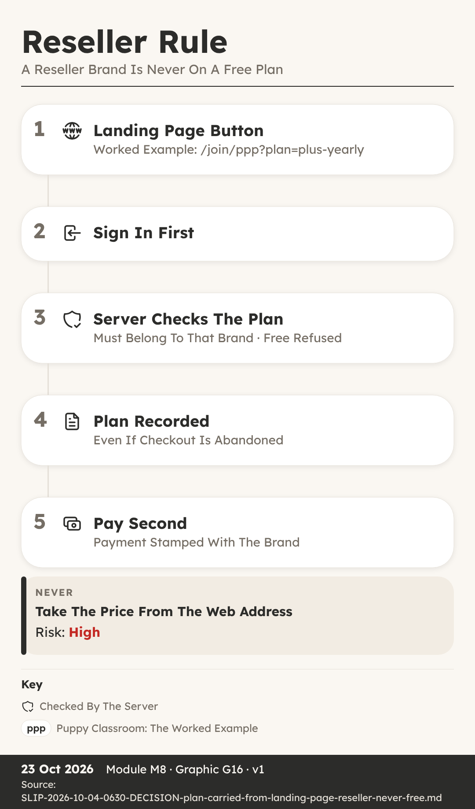{width=60%}

## Sales Page, Domain And Funnels

**You can:** explain what a domain, DNS and a funnel are, and why a reseller's brand is never on a free plan.

**Key Ideas**

- **A Free Button That Was Refused.** He was helping to put together a page for Northvale Canine Society, the club that resells Litterline to its members under its own name.
- **Stage 7 Happens On The Runway.** It happens in the room called Runway, which is tagged Brand, because this is where the app meets the outside world under each brand's name.
- **The Sales Page And Launch Price.** The sales page explains what the app does, who it is for and what it costs.
- **Domain And DNS In Plain Words.** A domain is the name of a website, the words people type to find it.
- **Funnels Lead People Step By Step.** A funnel is a short series of pages that leads a visitor from a first look to signing up or paying.
- **ClickFunnels Holds Contacts, Not The Keys.** The simplest route is a built-in connection that sends sign-ups and tags across.
- **The Plan Travels With The Click.** Each button on a landing page carries both the brand and the plan inside its link.
- **A Reseller Brand Is Never Free.** Free is decided per brand offer, never for the whole app.

**Recap**

- DNS Points The Domain At The App
- The Link Carries Brand And Plan, Never Price
- A Reseller Brand Is Never On A Free Plan

> **Why It Matters:** Every Click Must Land On A Recorded, Checked Plan

**Quick Quiz**

1. What does DNS do?

    A) It designs the sales page
    B) It takes payments at checkout
    C) It points a domain name at the server where the app lives
    D) It tests every table for leaks

2. What does a landing page button carry inside its link?

    A) The brand and the plan
    B) The price and a discount
    C) The member's password
    D) A ClickFunnels key

3. Why is the price never taken from the web address?

    A) Web addresses are too short
    B) Prices change every day
    C) ClickFunnels does not allow it
    D) Anyone can edit a web address

4. Which brands may offer a free plan?

    A) Every brand, including resellers
    B) The factory owner's own brands, never a reseller's
    C) Only reseller brands
    D) No brand, ever

**My Notes**

\_\_\_\_\_\_\_\_\_\_\_\_\_\_\_\_\_\_\_\_\_\_\_\_\_\_\_\_\_\_\_\_\_\_\_\_\_\_\_\_

\_\_\_\_\_\_\_\_\_\_\_\_\_\_\_\_\_\_\_\_\_\_\_\_\_\_\_\_\_\_\_\_\_\_\_\_\_\_\_\_

## The Launch Walk And Boosts

**You can:** name the checks that come before the Launch gate and explain why the weekly boost is still only proposed.

**Key Ideas**

- **It Worked On The Laptop.** She tried the new Stayproof site on her laptop, signing up as a brand-new kennel worker, and everything worked.
- **Leak Test Every Table, Two Accounts.** Before launch, the leak check runs one last time, and it is strict.
- **The Launch Walk, Desktop And Phone.** Before the gate, a brand-new account for each brand walks the whole journey on the live site, on desktop and on phone, including email links opened on the phone.
- **The User-Switch Test.** Then comes the user-switch test, a standard check on every app.
- **Checkout Tested On The Live Link.** Checkout is tested on the live link with a 100 percent off test code: buy, sign in, and get access.
- **Support Route, Then The Launch Gate (7-8).** The support route is tested too, so a real person with a problem can actually reach help.
- **Weekly Boost: Proposed, Not A Rule.** The factory's template has a weekly boost line: a weekly proposal of ways to help the app get found, using parts from the Boost shelf, such as public pages, reviews, search visibility and funnels.
- **Ready For Real Users.** So before an app opens to real users, it passes a leak test on every table with two accounts, a launch walk on desktop and phone, a user-switch test, a live checkout test, legal and consent checks and a tested support route.

**Recap**

- Leak Test Every Table With Two Accounts
- Walk The Journey New, On Desktop And Phone
- The Owner Always Decides The Launch Gate (7-8)

> **Why It Matters:** Real Users Deserve An App Proved On Every Path

**Quick Quiz**

1. Why does the launch walk include a phone?

    A) Phones are faster to test on
    B) The sales page is only shown on phones
    C) Phones never need a sign-in
    D) Email links opened on a phone can break a journey that works on desktop

2. What does the user-switch test check?

    A) That two users can share one account
    B) That user B sees none of user A's name or settings in the same browser
    C) That users can switch brands freely
    D) That the owner can sign in as anyone

3. Why is checkout tested on the live link?

    A) Checkout never works in preview
    B) The live link is free to use
    C) Preview has no buttons
    D) The test code only works on phones

4. What is the status of the weekly boost?

    A) A gate the owner must pass
    B) A rule that runs every day
    C) Proposed, not yet a rule
    D) Retired and no longer used

**My Notes**

\_\_\_\_\_\_\_\_\_\_\_\_\_\_\_\_\_\_\_\_\_\_\_\_\_\_\_\_\_\_\_\_\_\_\_\_\_\_\_\_

\_\_\_\_\_\_\_\_\_\_\_\_\_\_\_\_\_\_\_\_\_\_\_\_\_\_\_\_\_\_\_\_\_\_\_\_\_\_\_\_

# M09 · Stage 8 · Operate

*Watching Every Day, The Money Line, Rescue, Retire And Recycle*

How a live app is watched every day, judged by one money line each month, and rescued, retired or recycled when the time comes.

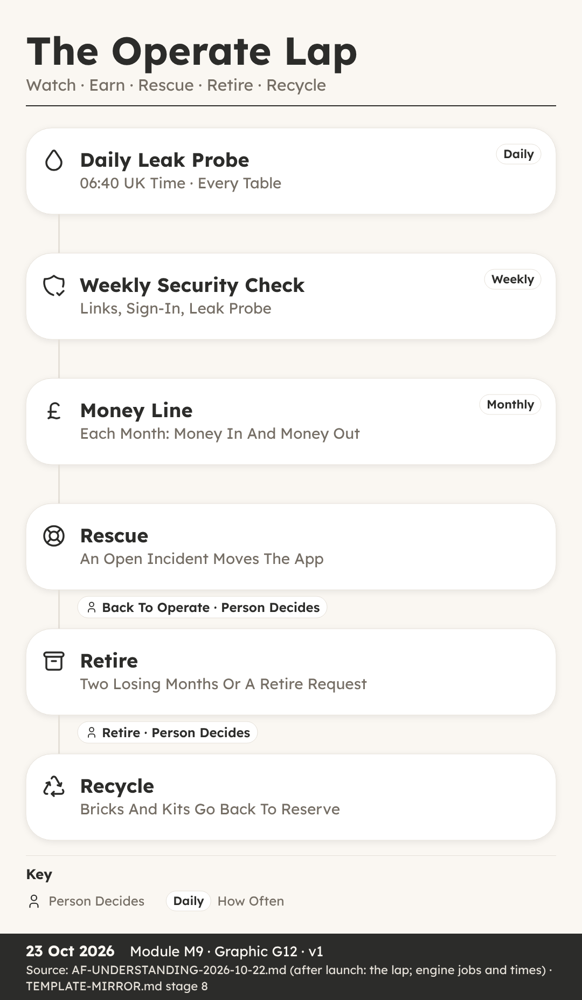{width=60%}

## Watching A Live App Daily

**You can:** explain the daily, weekly and monthly checks that watch a live app, and when each one runs.

**Key Ideas**

- **A Live App Is Not Finished.** Isla spent weeks helping a team launch Litterline, the licence and records hub for dog breeders.
- **Stage 8 Is Called Operate.** Stage 8 is Operate, and its room is called Radar.
- **The Engine Refreshes Every 15 Minutes.** The engine is a script, which means a small program that runs on a timer and does the same job the same way each time.
- **The Daily Leak Probe At 06:40.** The most important morning job is the leak probe, at 06:40 UK time.
- **More Jobs On The Clock.** The leak probe has neighbours on the clock.
- **The Weekly Security Check.** When an app goes live, it joins the weekly security check.
- **Monthly Numbers And New Parts.** The app's KPIs, short for key performance indicators, are compared with the targets set for it.
- **Scripts Watch, People Decide.** Scripts and AI helpers run the probes, the backups and the counts, and they record every result so it can be proved later.

**Recap**

- Leak Probe Runs Daily At 06:40 UK Time
- Weekly Security Check: Live Pages, Sign-In, Leak Probe
- Engine Refreshes The Picture Every 15 Minutes

> **Why It Matters:** A Live App Serves Real People Every Single Day

**Quick Quiz**

1. At what time does the daily leak probe run?

    A) 05:20 UK time
    B) 06:10 UK time
    C) 06:40 UK time
    D) 07:30 UK time

2. What does the weekly security check cover for each live app?

    A) Prices, logos and fonts
    B) Live links, sign-in and the leak probe
    C) Only the sales page
    D) New feature ideas

3. When the probe asks a private table for data while signed out, what is the right answer?

    A) A refusal
    B) A full list of records
    C) The newest record only
    D) A copy of the app

4. What does rule R14 ask for after an app ships?

    A) Delete the old tables
    B) Raise all prices
    C) Retire the app
    D) New parts go back to the brick registry

**My Notes**

\_\_\_\_\_\_\_\_\_\_\_\_\_\_\_\_\_\_\_\_\_\_\_\_\_\_\_\_\_\_\_\_\_\_\_\_\_\_\_\_

\_\_\_\_\_\_\_\_\_\_\_\_\_\_\_\_\_\_\_\_\_\_\_\_\_\_\_\_\_\_\_\_\_\_\_\_\_\_\_\_

## The Money Line

**You can:** read a monthly money line and explain when the Return rule and the Retire question come in.

**Key Ideas**

- **Pages Of Reports, No Answer.** Sam looked after the numbers for Trimtable, the booking and client desk built for groomer Juno Platt at The Tidy Paw.
- **One Line Each Month.** It is written on the app's card, which is the one home of the app's facts, and it follows a fixed pattern.
- **A Person Writes The Line.** Not a script and not an AI helper.
- **Reading A Losing Month.** Suppose Trimtable's line says in 90, out 140.
- **Two Losing Months Running.** If the money line shows two losing months running, the engine asks the Retire question.
- **The Return Rule, R02.** There is a second money rule, called Return, ruling R02.
- **Return Is Still A Manual Check.** It is a line on the stage 8 checklist, done by an AI helper and answered with a dated note in the app's document, in the part about payoff.
- **A Record, Not A Promise.** The money line is a record of what happened, never a forecast of what will happen.

**Recap**

- Money Line Each Month: In X Out Y
- Two Losing Months Running Asks The Retire Question
- Return R02 Guards The Next Invest

> **Why It Matters:** One Honest Line Beats A Pile Of Charts

**Quick Quiz**

1. What does the monthly money line record?

    A) Sign-ins and page views
    B) Money in and money out
    C) The number of tables
    D) Leak probe results

2. What happens after two losing months running?

    A) The app is deleted at once
    B) Prices go up by themselves
    C) A person is asked the Retire question
    D) The app moves to Research

3. What does the Return rule R02 say?

    A) No new Invest until the app earns back its credits, or 90 days of use show it will
    B) Every app must make money in its first week
    C) Apps return to stage 0 each year
    D) Refunds are never given

4. Who writes the monthly money line?

    A) The leak probe
    B) A visitor to the sales page
    C) The building platform
    D) A person, as named work on the checklist

**My Notes**

\_\_\_\_\_\_\_\_\_\_\_\_\_\_\_\_\_\_\_\_\_\_\_\_\_\_\_\_\_\_\_\_\_\_\_\_\_\_\_\_

\_\_\_\_\_\_\_\_\_\_\_\_\_\_\_\_\_\_\_\_\_\_\_\_\_\_\_\_\_\_\_\_\_\_\_\_\_\_\_\_

## Rescue, Retire And Recycle

**You can:** follow a live app through Rescue, Back to Operate, Retire, Recycle, Recovery and Re-imagine.

**Key Ideas**

- **An Incident Before Breakfast.** Rory kept an eye on Stayproof, the inspection pack used by Hollin Lane Kennels.
- **The Trouble Gate Is Automatic.** Three gates belong to the lap rather than the road: Trouble, Back to Operate and Retire.
- **A Fix Capped To The Break.** The fix re-enters the road at the Slot check, which sits inside the Invest gate.
- **Fast, But Still Approved.** A person still approves the sending of every paid build prompt, exactly as in Stage 6.
- **Back To Operate.** A yes moves Stayproof out of Rescue and back to Radar, where the daily checks carry on as before.
- **Retire Is The Only Way Out.** Retire is the last lap gate, and the only way an app ever leaves the factory.
- **Recycle Sends Parts To Reserve.** Next comes Recycle, whose room is tagged Parts Back.
- **Recovery Holds Killed Ideas.** If an idea is killed before any parts exist, for example at the Screen gate, it goes to the Recovery room, tagged Killed Or Held.
- **Re-imagine Starts A New Journey.** It is a door, not a stamp, meaning nobody has to approve a gate to open it.

**Recap**

- Trouble Gate Moves A Broken App To Rescue
- Retire Is The Only Way Out; A Person Decides
- Parts Go To Reserve; Killed Ideas Go To Recovery

> **Why It Matters:** Fast Fixes And Clean Endings Keep The Factory Honest

**Quick Quiz**

1. What moves a live app into Rescue?

    A) A person's vote each Friday
    B) Two losing months running
    C) A new feature idea
    D) An open incident tagged to the app

2. Why can a rescue fix move quickly?

    A) One build lane is always kept empty for rescue
    B) It skips the send approval
    C) It skips every test
    D) It uses a free platform

3. Where do a retired app's bricks, kits and proved formations go?

    A) Reception
    B) Recovery
    C) Reserve
    D) Runway

4. What does Re-imagine do?

    A) Deletes the app and its row
    B) Points the same assembly at a new audience under a new id
    C) Renames the old app
    D) Moves the app back to stage 0

**My Notes**

\_\_\_\_\_\_\_\_\_\_\_\_\_\_\_\_\_\_\_\_\_\_\_\_\_\_\_\_\_\_\_\_\_\_\_\_\_\_\_\_

\_\_\_\_\_\_\_\_\_\_\_\_\_\_\_\_\_\_\_\_\_\_\_\_\_\_\_\_\_\_\_\_\_\_\_\_\_\_\_\_

# M10 · Your First Idea

*Filling In The Idea Form, Where To Go Next*

A worked walk through the Litterline idea form, then your own idea, the Vision 2029 picture and the honest next steps.

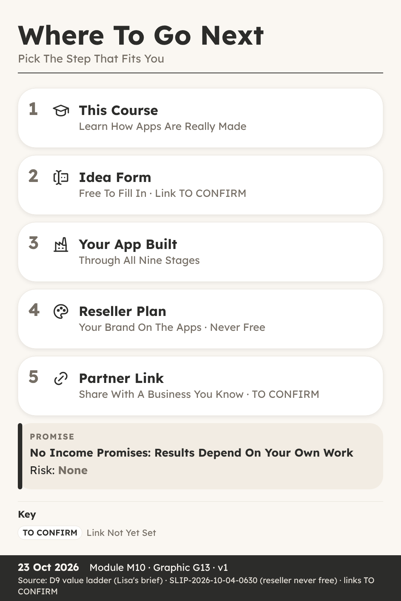{width=60%}

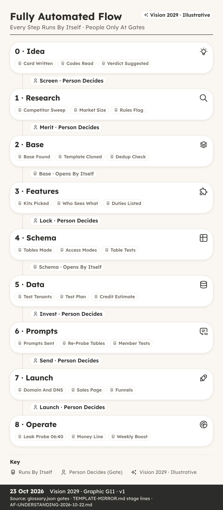{width=60%}

## Filling In Your First Idea Form

**You can:** fill in an idea form, using the fictional Litterline as a worked example.

**Key Ideas**

- **A Sticky Note And A Blank Form.** Ava had followed the whole course, and she had an app idea of her own written on a sticky note by her desk.
- **Four Doors Into The Factory.** Every idea enters the factory through one of four doors.
- **Name First, Then The Brief.** The form starts with a short name: Litterline.
- **Group 1: Businesses, Six Codes.** Each code is a word plus a number.
- **Group 2: Who Signs In.** ROLE (0-2) is 2, roles with different access, so a breeder and their helper need not see the same things.
- **Groups 3 And 4: Customers, Public.** CUST (0-5) is 3, customers write, so puppy buyers can add to their records.
- **Kill Check, Verdict, Data Role.** In our worked example all three are answered no, partly because licences renew, which brings breeders back.
- **Now Fill In Your Own.** Take your own idea and write a short name, then the three-part brief: what it is, who pays, and the pain it removes.

**Recap**

- Brief Is Three Answers: What, Who Pays, Pain
- Six Codes Required, Fourteen May Say Not Yet Known
- No Kill Answer And SEN Below 2 Means PASS

> **Why It Matters:** A Clear Form Gives Your Idea A Fair Hearing

**Quick Quiz**

1. Which three answers make up the brief?

    A) Name, logo and colour
    B) What it is, who pays, and the pain
    C) Price, domain and funnel
    D) Tables, walls and tests

2. Litterline is TEN 3. What does level 3 mean?

    A) One business
    B) No data stored
    C) Several bodies
    D) One reseller above

3. How many of the 20 codes are required?

    A) Six
    B) Four
    C) Fourteen
    D) All 20

4. Litterline has no kill answers and SEN 1. Which verdict does the engine suggest?

    A) KILL
    B) HOLD
    C) PASS
    D) RESHAPE

**My Notes**

\_\_\_\_\_\_\_\_\_\_\_\_\_\_\_\_\_\_\_\_\_\_\_\_\_\_\_\_\_\_\_\_\_\_\_\_\_\_\_\_

\_\_\_\_\_\_\_\_\_\_\_\_\_\_\_\_\_\_\_\_\_\_\_\_\_\_\_\_\_\_\_\_\_\_\_\_\_\_\_\_

## Where To Go Next

**You can:** describe the Vision 2029 picture and the honest next steps on the value ladder.

*Vision 2029 · Illustrative*

**Key Ideas**

- **After The First Idea.** Leah finished the course with one idea form filled in, and she wanted to know what could come after a single idea.
- **Vision 2029, Illustrative.** Everything in the next two parts is Vision 2029, illustrative.
- **A Morning In The 2029 Picture.** The leak probe reports All Clear across 18,240 tables.
- **People Still Decide At Gates.** Even in the vision, automation does the checking and the carrying between gates, and a person still decides at the human gates.
- **What A Value Ladder Is.** A value ladder is a set of steps, where each step offers a little more help for the people who want it, and nobody has to climb higher than suits them.
- **Learn, Then Send An Idea.** The course explains how an idea becomes a live app: stages, rooms, gates, codes, bricks, walls and tests, in plain words.
- **Built, Then Resold Under A Brand.** Step three is an app built for you, through the same stages and gates.
- **Partner Link And No Promises.** Step five is a partner link for the platform the factory builds on.

**Recap**

- Future Figures Are Always Vision 2029, Illustrative
- People Still Decide At The Human Gates
- A Reseller Brand Is Never On A Free Plan

> **Why It Matters:** Honest Steps Matter More Than Big Promises

**Quick Quiz**

1. What must every figure about the future carry in this course?

    A) A price
    B) The words Vision 2029, illustrative
    C) A leak test result
    D) A partner link

2. In the Vision 2029 picture, who decides at the human gates?

    A) Nobody, it is all automatic
    B) The building platform
    C) The first customer
    D) A person

3. Which plan can a reseller brand be on?

    A) Never a free plan
    B) Only the free plan
    C) Any plan typed into the web address
    D) No plan at all

4. What does the course promise about income?

    A) A fixed monthly amount
    B) Double your money in 90 days
    C) Nothing; results depend on your own work
    D) Earnings once you join

**My Notes**

\_\_\_\_\_\_\_\_\_\_\_\_\_\_\_\_\_\_\_\_\_\_\_\_\_\_\_\_\_\_\_\_\_\_\_\_\_\_\_\_

\_\_\_\_\_\_\_\_\_\_\_\_\_\_\_\_\_\_\_\_\_\_\_\_\_\_\_\_\_\_\_\_\_\_\_\_\_\_\_\_

# Quiz Answers

- **M00-L1 What An App Is Made Of:** 1B · 2C · 3A · 4D
- **M00-L2 The Road, Rooms And Gates:** 1C · 2B · 3D · 4A
- **M01-L1 The Idea Form:** 1B · 2D · 3A · 4C
- **M01-L2 The 20 Codes:** 1C · 2A · 3D · 4B
- **M01-L3 Kill Check, Verdict And Data Role:** 1C · 2B · 3D · 4A
- **M02-L1 The Research Sweep:** 1D · 2C · 3A · 4B
- **M02-L2 The Merit Gate:** 1C · 2D · 3A · 4B
- **M03-L1 Picking A Base:** 1B · 2A · 3C · 4D
- **M03-L2 Bricks, Shelves And Kits:** 1B · 2D · 3A · 4C
- **M04-L1 Choosing Kits And Bricks:** 1B · 2A · 3D · 4C
- **M04-L2 Duties And The Lock Gate:** 1C · 2A · 3D · 4B
- **M05-L1 How The System Makes The Tables:** 1B · 2D · 3A · 4C
- **M05-L2 Walls And Table Tests:** 1A · 2C · 3D · 4B
- **M06-L1 Test Identities And Test Tenants:** 1B · 2D · 3A · 4C
- **M06-L2 The Leak And Tenant Tests:** 1C · 2B · 3D · 4A
- **M07-L1 How Build Prompts Are Written:** 1D · 2A · 3C · 4B
- **M07-L2 After Every Paid Turn:** 1B · 2D · 3A · 4C
- **M08-L1 Sales Page, Domain And Funnels:** 1C · 2A · 3D · 4B
- **M08-L2 The Launch Walk And Boosts:** 1D · 2B · 3A · 4C
- **M09-L1 Watching A Live App Daily:** 1C · 2B · 3A · 4D
- **M09-L2 The Money Line:** 1B · 2C · 3A · 4D
- **M09-L3 Rescue, Retire And Recycle:** 1D · 2A · 3C · 4B
- **M10-L1 Filling In Your First Idea Form:** 1B · 2D · 3A · 4C
- **M10-L2 Where To Go Next:** 1B · 2D · 3A · 4C

# Next Step

Fill in the Idea Form (TO CONFIRM). Resellers: A Reseller Brand Is Never On A Free Plan. Partner link: TO CONFIRM (OverSkill partner link).

No income promises. Results depend on your own work.
